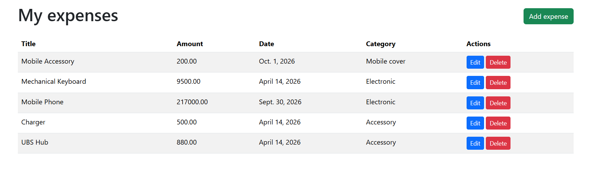

# Django Expense Tracker

A simple web application for keeping track of personal expenses. You can log in, view all expenses in a table, add new ones, edit existing ones, and delete the ones you no longer need. All pages are protected by login.

I built this as my first Django project while moving from Python fundamentals (OOP, decorators) into web development.



## Features

- View all expenses in a clean, striped table
- Add a new expense (title, amount, date, category) with a calendar date picker
- Edit and delete existing expenses
- Login system using Django's built-in authentication
- Pages protected with `@login_required`, so logged-out visitors are redirected to the login page
- Django admin site for managing data
- Bootstrap 5 styling, with a shared base template used by every page

## Built with

- Python 3.12
- Django 6.1
- SQLite
- HTML and Bootstrap 5

## How it is organized

| Part | File | What it does |
| --- | --- | --- |
| Model | `tracker/models.py` | `Expense` with title, amount, date, and category |
| Form | `tracker/forms.py` | `ExpenseForm`, a `ModelForm` with Bootstrap widgets |
| Views | `tracker/views.py` | List, add, edit, and delete views |
| URLs | `tracker/urls.py` | Maps addresses to views |
| Templates | `tracker/templates/` | `base.html` parent template plus list, form, and login pages |

## How to run it

1. Clone the repository:

   ```
   git clone https://github.com/hassanmehmuod/django-expense-tracker.git
   cd django-expense-tracker
   ```

2. Create and activate a virtual environment (Windows):

   ```
   python -m venv venv
   venv\Scripts\activate
   ```

   On macOS or Linux, activate it with `source venv/bin/activate` instead.

3. Install the dependencies:

   ```
   pip install -r requirements.txt
   ```

4. Create the database tables:

   ```
   python manage.py migrate
   ```

5. Create a user account so you can log in:

   ```
   python manage.py createsuperuser
   ```

6. Start the development server:

   ```
   python manage.py runserver
   ```

7. Open `http://127.0.0.1:8000/` in your browser and log in with the account you just created.

The admin site is available at `http://127.0.0.1:8000/admin/`.

## What I learned

- How a Django project is structured: models, views, URLs, and templates
- How a model class becomes a database table through migrations
- Using `ModelForm` to create and update records, including the redirect after a successful save
- Capturing values from the URL (`<int:pk>`) to edit and delete a specific record
- Protecting views with `@login_required`, a decorator like the ones I practiced in plain Python
- Reusing one parent template across pages with template inheritance

## Known limitations and next steps

- All logged-in users currently see the same expenses. Next step: link each expense to its owner so every user sees only their own.
- Delete happens as soon as the link is opened. A confirmation step, and a POST request instead of a link, would make it safer.
- Still to add: a logout link, a total of all expenses, and tests.
- The `SECRET_KEY` in `settings.py` is the default development key. A real deployment would load it from an environment variable.

## Author

Hassan Mahmood, [github.com/hassanmehmuod](https://github.com/hassanmehmuod)
